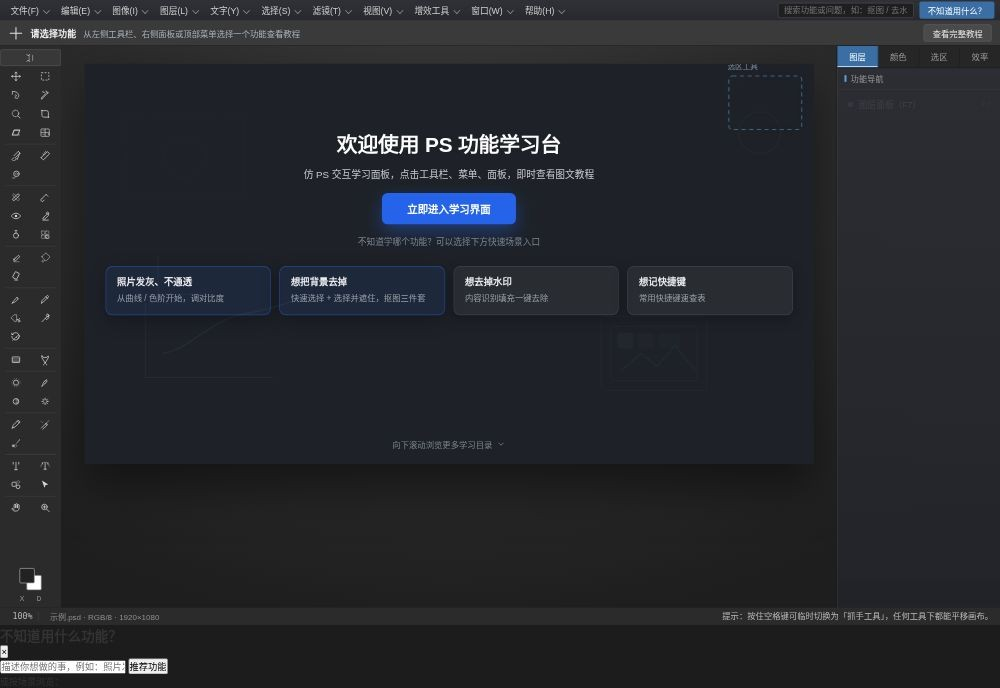
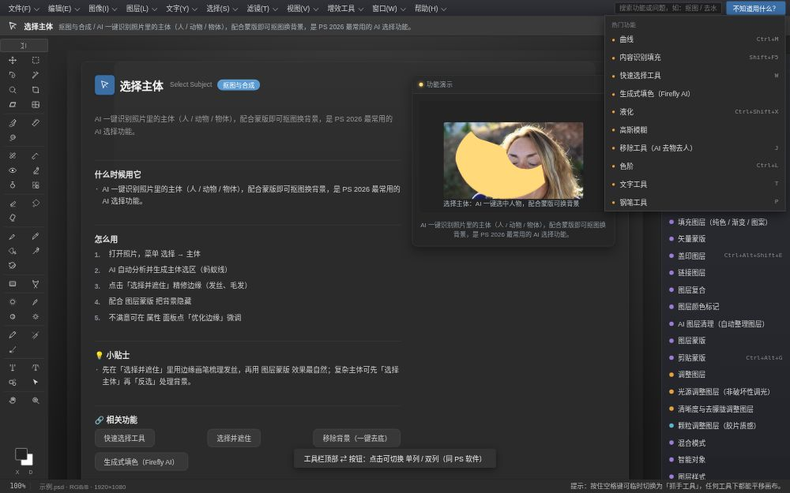
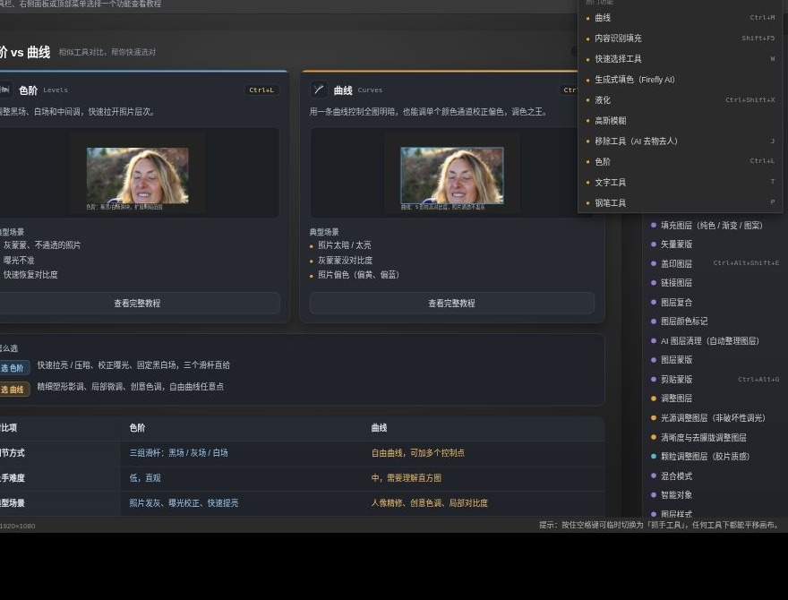
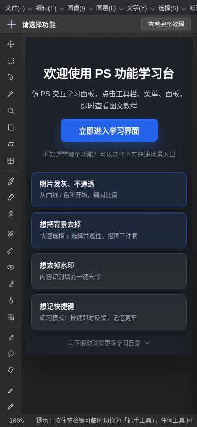

# PS 功能学习台 · PS Learning Studio

> 一个仿 Photoshop 交互界面的 PS 功能图文学习网页：点击工具栏、菜单或面板，即可查看对应功能的「什么时候用它 / 怎么用 / 小贴士 / 相关功能」图文教程。



## ✨ 功能特点

- **仿真 PS 界面**：顶部菜单栏、左侧工具栏、右侧功能导航与图层面板，深色主题，操作习惯贴近真实 PS
- **图文教程卡片**：每个功能包含适用场景、操作步骤、避坑小贴士与相关功能跳转
- **功能对比讲解**：相近工具（如 色阶 vs 曲线）并排对比，说明区别与适用场景
- **场景化入口**：照片发灰不通透、抠图去背景、去水印、记快捷键等高频场景直达
- **快捷键速查**：常用命令标注快捷键，支持练习模式按键即时反馈
- **响应式布局**：桌面双栏 / 移动端单列自适应

## 🖼️ 界面预览

### 教程面板（桌面端）



### 相近功能对比



### 移动端欢迎页



## 🚀 使用方式

无需安装任何依赖，直接在浏览器打开：

- 双击 `index.html`，或
- 本地启动一个静态服务：

```bash
# 任选其一
python3 -m http.server 8080
npx serve .
```

然后访问 `http://localhost:8080`。

## 📂 项目结构

```
├── index.html          # 全部页面、样式与脚本（单文件，无外部依赖）
├── screenshots/        # README 预览截图
└── README.md
```

## 🛠️ 技术栈

- 原生 HTML / CSS / JavaScript（ES6）
- 无框架、无构建步骤、无外部 CDN 依赖
- 示例图片与插画以 base64 内联，单文件即可离线运行

## 📚 覆盖内容（部分）

工具栏、选区、图层、蒙版、调色（曲线 / 色阶 / 色相饱和度等）、修复与仿制图章、文字与排版、滤镜、抠图合成、导出格式、快捷键速查……

---

> 本项目为个人学习与界面练习作品，与 Adobe Photoshop 无官方关联。
